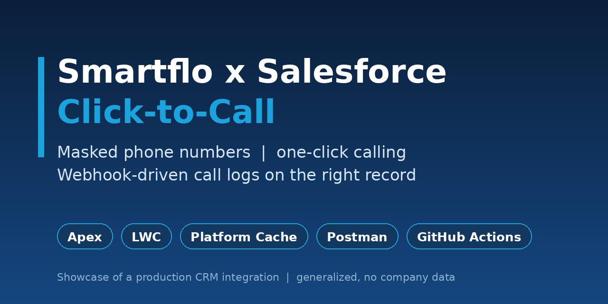
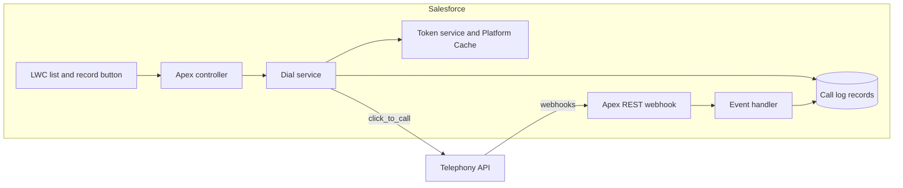
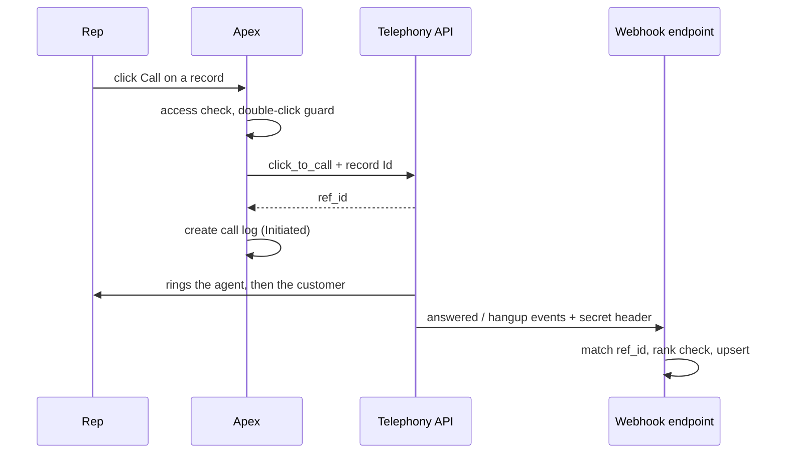

# Smartflo x Salesforce: masked click-to-call

A Salesforce integration that lets sales reps **call customers with one click without ever seeing the phone number**, and logs every call on the **exact record** it was started from. It works for internal users and Experience Cloud partner users.

> **About this repository.** This is a case-study showcase of a production CRM integration I designed and built. Company code, schema and data are intentionally not included. The code here is a set of rewritten, generalized patterns, and the documentation describes the full solution.

## The problem
- Reps could read customer numbers on screen, in reports, and in exports, and dialed them by hand.
- Calls were not logged reliably, and one lead can have several opportunities with the **same phone and the same owner**, so a call could land on the wrong one.
- Both internal users and external partner users needed the same capability.

## The solution at a glance
| Concern | How it is handled |
|---|---|
| Hide numbers | Server-side masking: field-level security + masked formula + a system-mode read that only happens after a user-mode access check |
| One-click calling | LWC calls Apex; Apex calls the telephony API. The browser never sees credentials or raw numbers |
| Right record | The record Id travels with the call and the vendor's returned `ref_id` becomes the unique key |
| Reliable logging | Webhooks are authenticated, idempotent, and ranked so late or duplicate events cannot corrupt a call |
| Credentials | External Credential for the login; the 1-hour token is cached in Platform Cache |
| Who can do what | Separate permission sets for callers, partner callers, the dialer team, and admins |

## Architecture

## What to read
| If you want to see... | Open |
|---|---|
| The full story, decisions and trade-offs | [docs/CASE_STUDY.md](docs/CASE_STUDY.md) |
| Components, data model, event ranking | [docs/ARCHITECTURE.md](docs/ARCHITECTURE.md) |
| Why each choice was made | [docs/DESIGN_DECISIONS.md](docs/DESIGN_DECISIONS.md) |
| The security and masking model | [docs/SECURITY_MODEL.md](docs/SECURITY_MODEL.md) |
| Real bugs I hit and how I fixed them | [docs/LESSONS_LEARNED.md](docs/LESSONS_LEARNED.md) |
| How it was tested | [docs/TESTING.md](docs/TESTING.md) and [postman/](postman/) |
| Working code patterns with unit tests | [apex-patterns/](apex-patterns/) |

## Code in this repo
Five small Apex classes that stand alone and have unit tests: `PhoneMask`, `PayloadUtil` (defensive webhook parsing, IST conversion), `CallEventRanker` (event status + rank guard), `WebhookAuth` (fail-closed shared-secret check) and `TokenCache` (shared token in Platform Cache). They are the reusable heart of the solution without any company schema.

## API tests
The [Postman collection](postman/) covers the telephony API (login, refresh, click-to-call, negative cases) and the Salesforce webhook endpoint (auth, event ordering, duplicate replay, stale events, unknown calls). Folder 3 targets a Salesforce endpoint that implements this contract (the private implementation), so for visitors it documents the expected behaviour rather than something runnable. The environment is a blank template; real values never go in git.

## Project status
| Area | State |
|---|---|
| Token login and caching | Verified in a sandbox |
| One-click call from a record as a non-admin user | Verified with real calls |
| Masked display on record page and list component | Verified |
| Call logged on the clicked record | Verified |
| Webhook handling and event ranking | Unit-tested; end-to-end run in progress |
| Missed-call status rules | Based on assumptions, pending real payloads |
| Partner (Experience Cloud) user | Pending |
| Automated deploy pipeline | Planned |

## Tech
Apex, Lightning Web Components, External and Named Credentials, Platform Cache, Custom Metadata, Experience Cloud, REST webhooks, Postman, GitHub Actions.

## Author
<Your Name>, Salesforce developer. [LinkedIn](https://www.linkedin.com/in/yogesh3singh)
